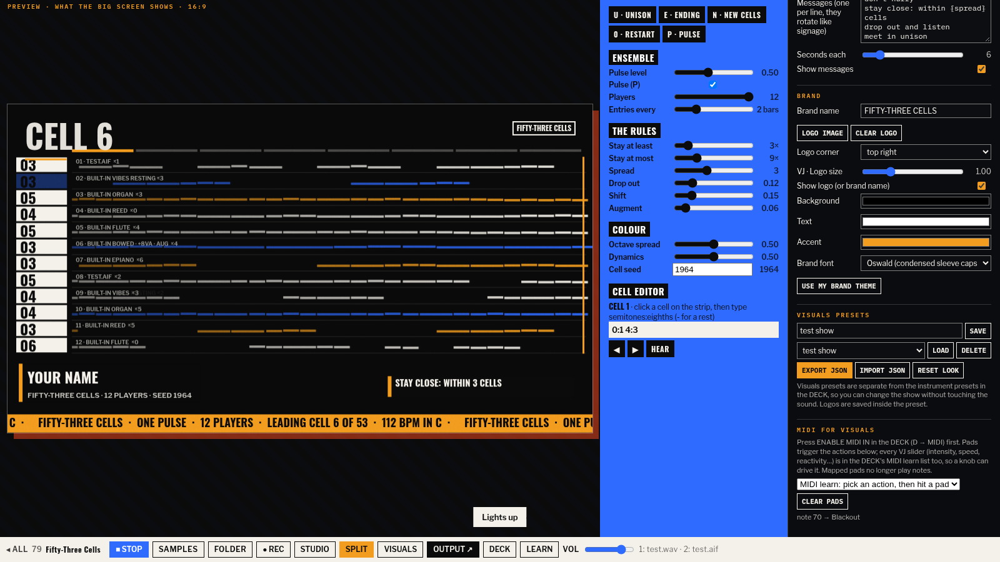

# Fifty-Three Cells

**Up to twelve players, fifty-three short cells, one steady pulse, and a big screen behind you.**

**Play it:** https://fifty-three-cells.netlify.app

This is the stand-alone, performance version of machine 79 in [Manifesto Machines](https://github.com/anorthernman-developer/manifesto-machines) ([original tool](https://anorthernman-developer.github.io/manifesto-machines/tools/79-in-c.html)). It is a homage to the process of *In C*, the 1964 minimalist piece by Terry Riley: every player walks through the same numbered cells in order, repeating each one as long as they like, staying close to the others, over an eighth-note pulse. **No part of that score is used.** The 53 cells here are written by the app from a seed, and you can rewrite any of them.

Everything the original tool does is still here. On top of that there is a **live visuals output** that follows the ensemble: you play on the laptop while the projector shows who is where.



## What is in it

**The instrument (from tool 79, all kept)**
- **Up to 12 players**, each walking through 53 cells at their own pace. They enter one by one, stay between a minimum and maximum number of repeats, keep within a spread of cells of each other, drop out to listen, shift by an eighth, augment and change octave.
- **Cells written by the app**, not taken from any score. N writes a new set of 53 from a new seed. The cell editor lets you rewrite any cell as `semitones:eighths` (use `-` for a rest), and HEAR plays it.
- **Unison** (U) brings everyone onto the leading cell. **The ending** (E) moves everyone on towards cell 53, and they stop one by one; the pulse ends last. 0 restarts from cell 1, P turns the pulse on or off, + and − add or remove players.
- **Your own samples**: WAV, AIFF or MP3, one at a time or a whole folder (SAMPLES, FOLDER, or drag and drop onto the page). Slot 1 is the pulse, slots 2 to 8 are the player timbres, shared out across the players.
- Each slot has pitch, gain, filter, pan, reverb, delay, reverse and mute, and **START and END trim on a waveform with draggable handles**. Drag the nearest handle, shift-drag to move the whole region, double-click to reset.
- Presets saved in your browser, with JSON export and import. Web MIDI with MIDI learn, a WAV recorder, the limiter, keyboard shortcuts and the LEARN panel are all still there.

**Live visuals (new)**
- **Eight scenes made for a process piece:** Player Lanes (a scrolling roll per player), Cell Strip (all 53 cells with the players sitting on them), Pulse (op-art rings on the eighth notes), Phase Wheel (each player a ring carrying its cell, lighting up when they coincide), Overlap Score (a graphic score of who was where, with the spread as a band), Big Type (the leading cell, huge and cropped), Signage (a station board) and Sample Scope (your sample with its START/END region and playhead).
- **Auto-cycle** by timer, every N bars, on each new leading cell, or on each unison or ending. Choose which scenes are included and how they change: fade, wipe, flash or cut.
- **Themes named after styles, not people:** Jazz sleeve (default), Swiss grid, Bauhaus primaries, Op art, Psychedelic poster, Graphic score, Acid rave, Monochrome minimal, Grunge type and **Your brand**. "Harmony moods" changes the look as the leading cell moves through the harmonic areas.
- **Text layers:** a headline, artist and track lower third, a scrolling ticker and rotating messages, with live tokens: `{cell} {min} {players} {spread} {seed} {bpm} {key} {area} {section} {bar} {time} {date} {artist} {brand} {sample}`.
- **Brand:** name, logo upload, logo corner and size, background, text and accent colours, and font.
- **Live sliders:** intensity, speed, reactivity, trails, unison flash, glitch, grain, text size, logo size and ticker speed. Every one can be MIDI-learned in the DECK.
- **BLACKOUT** (K) and **FREEZE** (F).
- **Visuals presets**, separate from the sound presets: seven factory looks, plus save, load, delete, and export or import as JSON.
- **MIDI pads for visuals and the ensemble:** pick an action (scene 1 to 8, next, previous, blackout, freeze, cycle, theme, message, unison, ending, restart), then hit a pad.

## Three layouts

| Layout | What you see | Key |
|---|---|---|
| **SPLIT** (default) | Live 16:9 preview on the left, instrument and visuals controls on the right | G cycles the layouts |
| **STUDIO** | The original instrument, full size | G |
| **VISUALS** | Visuals only, full window (single-screen setups) | G, Esc to go back |

**OUTPUT ↗** (or O) opens a separate output window with no controls in it, for the projector. Open several if you have several screens.

## Live setup: laptop and projector

1. Plug the projector or big screen into the laptop.
2. In your display settings choose **Extend**, not Mirror (Mac: System Settings → Displays; Windows: Win+P → Extend).
3. Open the app in **Chrome or Edge** and press **▶ PLAY** once. Browsers only start audio after a click.
4. Press **OUTPUT ↗**. A new window opens. **ON PROJECTOR** places it on the second screen for you where the browser allows it; otherwise drag it across.
5. **Click the output window**, or press **F**, for full screen. The cursor hides after two seconds.
6. Back on the laptop the status reads `OUTPUT: 1 window connected`. Scene, theme, text, brand, blackout and freeze changes appear on the big screen straight away, and the visuals follow every note the ensemble plays.

Tips
- If the output says it lost the controller, the controller tab was closed or reloaded. Press OUTPUT again, or leave the output open: on the Netlify site it reconnects when the controller comes back.
- Sound check in **SPLIT**, then switch to **STUDIO** for more room. The output keeps running either way.
- It also runs offline from disk (`file://`). The output window still syncs through the window that opened it. Without the internet the browser uses system fonts.

## Keys

| Key | Action |
|---|---|
| U | Unison on the leading cell |
| E | The ending |
| N | Write 53 new cells |
| 0 | Restart from cell 1 |
| P | Pulse on or off |
| + / − | More or fewer players |
| ← / → | Previous / next cell in the editor |
| Shift+1–8 | Visuals scene |
| [ and ] | Previous / next scene |
| C | Auto-cycle on/off |
| T | Next theme |
| J | Next message |
| K | Blackout |
| F | Freeze (in the output window F means full screen) |
| O | Open an output window |
| G | Change layout |
| Esc | Leave visuals-only |
| D | The DECK (sounds, presets, MIDI, keys) |
| Space | Play / stop |
| R | Record to WAV |
| L | LEARN panel |

## How it works

A static site: no build step, no server, no keys, no tracking. Plain `<script>` files run in order, so it works from `file://` too.

- `js/meta.js`: names, credits and LEARN text
- `js/mm-kit.js`: audio engine, limiter, recorder and MIDI (the Manifesto Machines kit)
- `js/mmx-deck.js`: sample slots, waveform handles, presets and MIDI learn
- `js/cells.js`: the instrument (tool 79). It also posts ensemble events (pulse, note, bar, cell change, unison, ending) for the visuals.
- `js/vj-engine.js`: scenes, themes, overlays and transitions. The same renderer runs in the preview and the output window.
- `js/live.js`: the controller: analyser on the master bus, layouts, visuals panel, presets, MIDI pads and sync
- `output.html` + `js/output.js`: the projector window

The controller sends about 60 small frames a second (spectrum, levels, every player's cell and state, notes sounded) over `BroadcastChannel('ftc-live')`, and by `postMessage` to the windows it opened. The 53 cells are sent separately whenever they change. Each output window renders by itself, so the projector runs at its own full frame rate and resolution.

## Tests

`test/run.js` drives headless Chrome with Playwright. It checks the audio level and analyser, opens the output window, and checks sync of scene, text, theme, blackout, freeze, 12 players, unison, an edited cell and the START/END region. It renders all eight scenes, tests harmony moods and auto-cycle, loads a WAV and an AIFF, drags the waveform handles (including shift-drag and double-click reset), and tests instrument presets, visuals presets (save, load, export, import) and visuals MIDI learn with a simulated note. Any console error fails the run.

```
npm i playwright-core            # once; set CHROME if Chrome is not at /usr/bin/google-chrome
python3 -m http.server 8099 &    # then:
node test/run.js http            # local server
node test/run.js file            # straight from disk
node test/run.js https://fifty-three-cells.netlify.app
```

## Credits and compliance

- Machine 79 of [Manifesto Machines](https://github.com/anorthernman-developer/manifesto-machines). MIT licence.
- A homage to *In C* (Terry Riley, 1964). Not affiliated with or endorsed by the composer or publisher. **No score, text or recording of that work is reproduced**: the cells, rules wording and sounds are the app's own.
- Visual themes are named after broad design styles; no artist's name, artwork or logo is used.
- No personal data is collected. Settings and presets stay in your browser's `localStorage`. This app needs no API key and none is stored in the repository.
